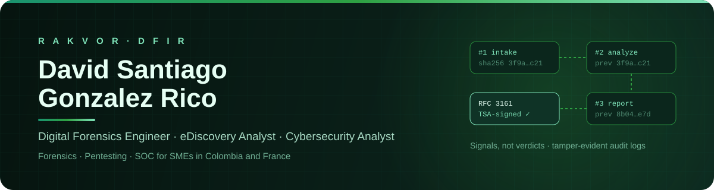
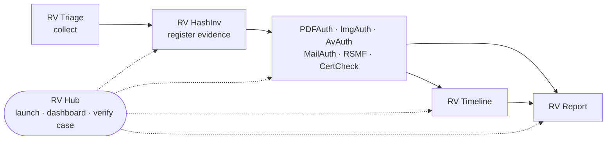
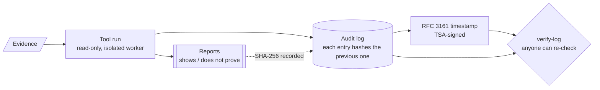
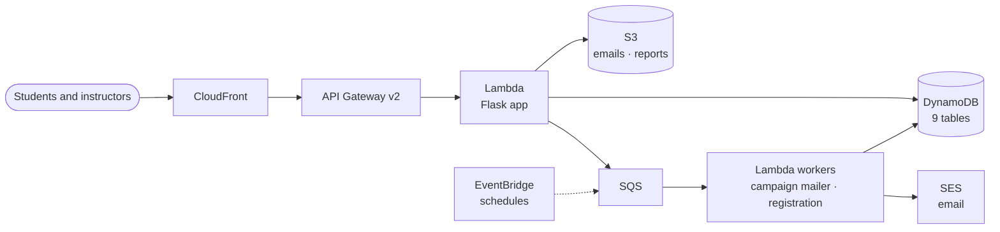

  

<h1 align="center">David Santiago Gonzalez Rico</h1>

<strong>Digital forensics · Pentesting · SOC — for SMEs in Colombia and France</strong>

  

  I build <strong>Rakvor</strong>, a suite of digital-forensics tools written in Rust for examiners who have to
  defend their findings in court. Every tool reports <em>signals, not verdicts</em>, and keeps a tamper-evident record of
  everything it did.

  
  
  

  
  
  
  
  

## The Rakvor DFIR suite

  

Start with **[RV Hub](https://github.com/Panacota96/rv-hub)**: the one window an examiner opens first. It finds the
installed tools, checks their signatures, launches them on a case folder, shows the case at a glance and verifies the
whole case. The other tools stay separate, separately signed programs.

| Tool | What it does | Latest |
| --- | --- | --- |
| [**RV Hub**](https://github.com/Panacota96/rv-hub) | Front door: finds and verifies the tools, launches them on a case, verifies the whole case. |  |
| [**RV Triage**](https://github.com/Panacota96/rv-triage) | Live Windows triage from a USB stick: volatile data, event logs, hives, prefetch, browsers, tasks, into a hashed, logged package. |  |
| [**RV HashInv**](https://github.com/Panacota96/rv-hashinv) | Evidence inventory: hashes every file, detects its real type, flags anomalies, registers the evidence of a case. |  |
| [**RV PDFAuth**](https://github.com/Panacota96/rv-pdfauth) | Signals of modification in PDFs: every saved revision extracted and compared visually, plus metadata, fonts, signatures and hidden content. |  |
| [**RV ImgAuth**](https://github.com/Panacota96/rv-imgauth) | Signals of modification in photos and screenshots (JPEG, HEIC, PNG, WebP): structure, metadata, double compression, ELA/noise maps, copy-move. |  |
| [**RV AvAuth**](https://github.com/Panacota96/rv-avauth) | Audio and video authenticity signals: container structure (MP4/MOV, Ogg/Opus, WAV, MP3) and encoder traces. |  |
| [**RV MailAuth**](https://github.com/Panacota96/rv-mailauth) | Email authenticity signals in .eml, .msg and .mbox: DKIM/ARC re-verified offline, Received path, dates, attachments, BEC signals. |  |
| [**RV RSMF**](https://github.com/Panacota96/rv-rsmf) | Converts WhatsApp, Telegram, Teams and mobile-tool CSV chat exports to validated RSMF 2.0 for Relativity, each message traced to its source line. |  |
| [**RV CertCheck**](https://github.com/Panacota96/rv-certcheck) | Validates X.509 chains, revocation, RFC 3161 tokens and trust lists found in evidence; also creates Rakvor's own PKI and lab certificates. |  |
| [**RV Timeline**](https://github.com/Panacota96/rv-timeline) | One cited super-timeline of a case, built from the verified runs of the other tools, with cross-source time signals. |  |
| [**RV Report**](https://github.com/Panacota96/rv-report) | Assembles one expert report (dictamen pericial / rapport d'expertise) from the verified runs, quoting each tool verbatim; never writes a conclusion. |  |

### See them working

All screenshots show synthetic sample evidence shipped with each tool.

<table>
  <tr>
    <td width="50%" align="center">
      
       <b>RV Hub</b> · installed tools, signature checked
    </td>
    <td width="50%" align="center">
      
       <b>RV PDFAuth</b> · revision viewer, changed amount highlighted
    </td>
  </tr>
  <tr>
    <td width="50%" align="center">
      
       <b>RV ImgAuth</b> · copy-move overlay
    </td>
    <td width="50%" align="center">
      
       <b>RV MailAuth</b> · message signals
    </td>
  </tr>
  <tr>
    <td width="50%" align="center">
      
       <b>RV Timeline</b> · case super-timeline
    </td>
    <td width="50%" align="center">
      
       <b>RV Report</b> · expert report preview
    </td>
  </tr>
</table>

## How they are built

- **Rust**, Windows 10/11, a command line and a desktop app for every tool.
- **Signed releases**: Authenticode signatures chaining to the Rakvor root, `SHA256SUMS` and build provenance on every release; RV Hub checks the chain before it launches a tool.
- **Tamper-evident audit logs**: every action is written to a hash-chained log that anyone can re-verify (`verify-log`), including the outputs it recorded.
- **RFC 3161 timestamps** on the audit logs, with the TSA signature checked on verification.
- **Signals, not verdicts**: no tool ever says "authentic" or "forged"; every finding states what it shows *and what it does not prove*.
- **Three languages**: interface and reports in English, Spanish and French, with Colombian and French report structures.
- **Independent QA harness**: the signed release executables are re-tested from outside the repositories, per tool and across the whole case workflow.
- **Source-available, non-commercial**: the code is published for audit under the PolyForm Noncommercial 1.0.0 licence.

### rakvor-tool-forge

[**rakvor-tool-forge**](https://github.com/Panacota96/rakvor-tool-forge) is the skill that turns "we need a tool that
does X" into a Rakvor tool that builds, passes its tests and meets the forensic contract from the first commit: a
phased procedure, reference templates (Rust and Python) and a contract validator that every tool must pass.

## Services

Through Rakvor I work with small and medium-sized businesses in **Colombia** and **France**:

- **Digital forensics**: evidence collection, document, image, email and chat authenticity, expert reports.
- **Pentesting**: authorized assessments of web applications, networks and infrastructure.
- **SOC**: monitoring, detection and incident response sized for SMEs.

## About me

**Roles:** Cybersecurity Analyst · eDiscovery Analyst · Digital Forensics Engineer

### Education

  
  

### Spoken languages

  
  
  

## Toolkit

  

### Digital forensics and mobile

  
  
  
  
  
  
  
  
  

### eDiscovery

  
  
  

### SOC, SIEM and EDR

  
  
  
  
  
  

### Pentesting

  
  
  
  
  
  

### Programming languages

  
  
  
  
  
  
  
  
  
  

### Cloud: AWS

  
  
  
  
  
  
  
  
  
  
  
  
  
  
  

[EnGarde](https://github.com/Panacota96/master-Project-Phishing), my phishing-awareness platform, runs serverless on AWS and is deployed with Terraform:

  
<strong>Operating systems and lab environments</strong>

   

  **Operating systems**

  

    
    
    
    
    
  

  **Lab and virtualized environments**

  

    
    
    
  

### Other projects

- [EnGarde](https://github.com/Panacota96/master-Project-Phishing): serverless phishing-awareness platform for engineering students.
- [Guild-Scroll](https://github.com/Panacota96/Guild-Scroll): terminal flight recorder for CTFs and authorized pentests with structured reporting.
- [AI Cyber Lab](https://github.com/Panacota96/ai-cyber-lab): desktop-first cyber-lab workspace for CTF, pentest and AI-assisted reporting.
